Cornix용 ZMK 설정입니다. 왼쪽이 central이고 오른쪽이 peripheral입니다. 보드 정의는 [hitsmaxft/zmk-keyboard-cornix](https://github.com/hitsmaxft/zmk-keyboard-cornix) v3.0.1을 west 모듈로 가져옵니다.

공통 42키는 [zmk-config-corne](https://github.com/JinmuGo/zmk-config-corne)와 같습니다. 한쪽을 고치면 다른 쪽도 같이 고칩니다.

## 플래시

1. Actions 빌드 결과에서 펌웨어를 받습니다.
2. 양쪽을 UF2 모드로 두고 `cornix_reset.uf2`를 먼저 올립니다.
3. 왼쪽에 `cornix_left.uf2`, 오른쪽에 `cornix_right.uf2`를 올립니다.
4. 양쪽을 같이 리셋하고 다시 페어링합니다.

UF2 모드에 들어가지 않으면 upstream의 [bootloader 복구 가이드](https://github.com/hitsmaxft/zmk-keyboard-cornix/tree/main/bootloader)를 따릅니다.

`config/cornix.json`은 upstream에서 가져온 물리 배열이고 Apache-2.0 라이선스를 따릅니다.
